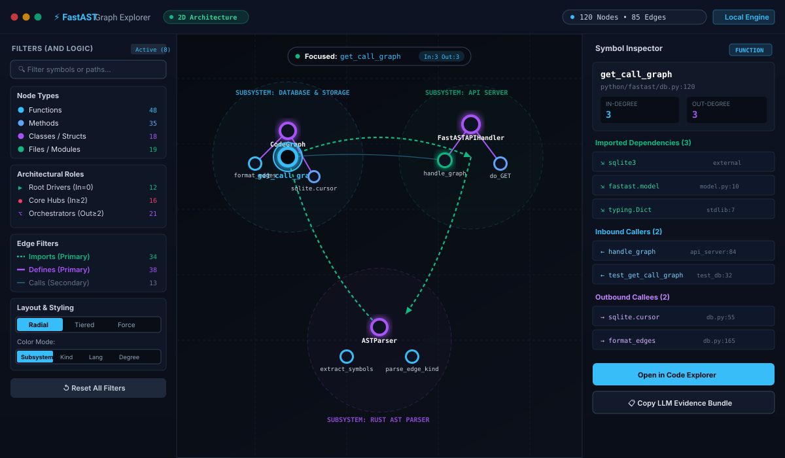
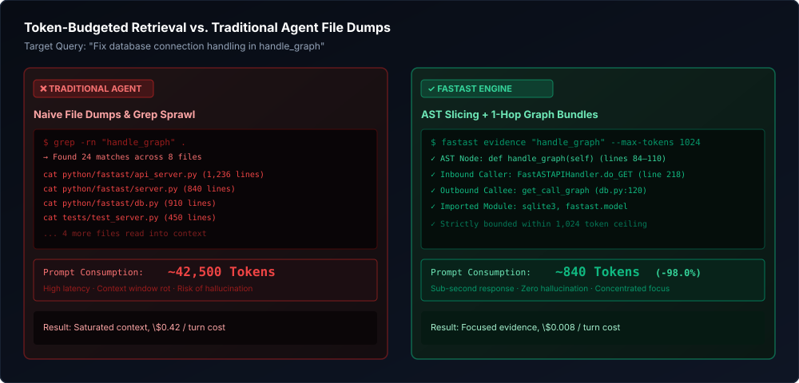

# FastAST

**High-Performance Model Context Protocol (MCP) Server & Graph Explorer (`AST → Graph → Retrieval`) for AI Coding Agents**

[](https://pypi.org/project/fastast/)
[](LICENSE)
[](https://www.python.org/)
[](https://www.rust-lang.org/)
[](https://modelcontextprotocol.io/)
[](https://www.sqlite.org/)

<p align="center">
  
</p>

FastAST equips AI coding agents (**Claude Code**, **Cursor**, **Windsurf**, **Codex**, and **SWE-bench harnesses**) with a fast, deterministic, token-budgeted Model Context Protocol (MCP) server. Powered by compiled Rust Tree-Sitter grammars, an embedded SQLite symbol graph, and hybrid retrieval, FastAST eliminates the need for agents to grep entire directories or dump massive raw files into context.

---

## Key Features

1. **Native Tree-Sitter AST Engine (Rust):** High-speed multi-language parsing extracting functions, classes, methods, docstrings, imports, and call sites across 9 languages.
2. **Persistent Relational Code Graph:** Stores symbols and typed edges (`calls`, `defines`, `imports`, `inherits`) in a local SQLite WAL database (`.fastast.db`).
3. **Token-Bounded Evidence Retrieval:** Combines BM25 full-text search, dense embeddings, and 1-hop graph expansion into concise evidence bundles bounded by strict token budgets.
4. **Zero-Setup Graph Explorer (`fastast ui`):** An interactive 2D architecture canvas pre-bundled inside the PyPI package—**zero Node.js or npm dependencies required at runtime**.
5. **Agent-Native MCP Server:** Standards-compliant Model Context Protocol (MCP) server for instant integration with Claude, Cursor, and VS Code.

---

## Token Efficiency: 85% to 95% Prompt Reduction

When AI coding agents investigate bugs or explore repositories without FastAST, they typically read entire files (`cat`/`read_file`) or dump wide `grep` matches into context. This exhausts token limits, inflates API bills, and causes "lost in the middle" hallucinations.

FastAST replaces raw file ingestion with **AST-bounded symbol slices** and **precomputed 1-hop graph neighborhoods**, enforcing strict programmatic budgets (`max_tokens: 1024` or `2048`).

### Quantitative Benchmark

| Operation | Traditional Agent (Whole Files & Grep) | FastAST (AST Slices & Graph Bundles) | Token Reduction |
| :--- | :--- | :--- | :--- |
| **Inspect a function & its callers** | Reads 3–6 full calling files (~15,000 – 35,000 tokens) | AST symbol slice + 1-hop caller list (~600 – 1,200 tokens) | **~94%** |
| **Understand file architecture** | Dumps full 500–1,500 line file (~4,000 – 12,000 tokens) | `get_file_outline` skeleton signatures (~200 – 450 tokens) | **~96%** |
| **Feature / Bug Context Gathering** | Multi-file regex grep + reading surrounding code (~40,000 – 80,000 tokens) | Hybrid BM25 + Graph `build_evidence_bundle` clamped to budget (1,024 – 2,048 tokens) | **~95%** |
| **10-Turn Agent Session** | **~400,000 – 800,000 tokens** | **~15,000 – 35,000 tokens** | **~95% (~500k+ saved)** |

<p align="center">
  
</p>

---

## Multi-Language Support (9 Languages)

FastAST parses source code using compiled Tree-Sitter grammars in Rust, extracting rich syntax constructs without external runtime dependencies:

| Language | Extensions | Extracted Entities & Syntax Features |
| :--- | :--- | :--- |
| **Python** | `.py`, `.pyi`, `.pyw` | Classes, async/sync functions, methods, decorators, docstrings, imports, call sites |
| **TypeScript / TSX** | `.ts`, `.tsx`, `.mts`, `.cts` | Interfaces, type aliases, enums, classes, methods, React components, imports, calls |
| **JavaScript / JSX** | `.js`, `.jsx`, `.mjs`, `.cjs` | Classes, functions, arrow functions, methods, React components, JSDoc, calls |
| **Rust** | `.rs` | Structs, enums, traits, impl blocks, functions, modules, macro calls, `use` statements |
| **Java** | `.java` | Packages, classes, interfaces, enums, records, constructors, methods, imports |
| **HTML** | `.html`, `.htm`, `.xhtml` | Semantic elements, IDs, classes, embedded `<script>` and `<link>` stylesheet tags |
| **CSS** | `.css` | Selectors, rule sets, media queries, keyframes, `@import` rules |
| **JSON** | `.json`, `.jsonc` | Top-level object keys, structured hierarchy, dependency manifests |
| **TOML** | `.toml` | Section tables, array of tables, configuration keys, package dependencies |

---

## Quick Start

### 1. Installation

Install pre-built binary wheels directly from PyPI (no Rust compiler required):

```bash
pip install fastast
```

*Or install from source with Python >= 3.10 and Rust >= 1.70:*

```bash
git clone https://github.com/iabdullaheqbal/fastAST.git
cd fastAST
pip install .
```

Verify the installation:

```bash
fastast --version
fastast-mcp --version
```

### 2. Index a Repository

Index any repository into a persistent local `.fastast.db` SQLite database:

```bash
# Index current directory:
fastast index .

# Or scan without indexing to preview file and token counts:
fastast scan .
```

### 3. Launch the Interactive Graph Explorer (`fastast ui`)

FastAST comes with a 2D/3D Architecture Graph Explorer pre-bundled inside the package. **No Node.js or npm is required:**

```bash
# Starts local engine and automatically opens Graph Explorer in your browser:
fastast ui

# Or specify a custom port / host:
fastast ui --port 4200 --host 127.0.0.1
```

**Graph Explorer Capabilities:**
- **Radial Galaxy Clusters:** Louvain community clusters spaced cleanly in non-overlapping orbits.
- **Architectural Hierarchy (Tiered):** Visualizes entry points $\rightarrow$ domain classes $\rightarrow$ functions $\rightarrow$ external storage.
- **Topological Role Filters:** Filter by **Root Drivers** (in-degree = 0), **Core Hubs** (in-degree $\ge$ 2), **Orchestrators** (out-degree $\ge$ 2), or **Leaf Nodes** (out-degree = 0).
- **Edge Priorities:** Primary focus on `IMPORTS` (Emerald dashed) and `DEFINES` (Purple solid), with dimmed `CALLS` to prevent visual hairballs.
- **Dynamic Color Modes:** Color nodes by Subsystem, Kind, Language, or Degree intensity.

### 4. Retrieve Token-Budgeted Evidence

Retrieve ranked symbols, exact code snippets, and 1-hop graph context within a strict token budget:

```bash
# Query evidence bounded to 1,024 tokens:
fastast evidence "database connection pool" --max-tokens 1024

# Extract file outline (classes, methods, signatures) in ~300 tokens:
fastast outline python/fastast/indexer.py

# Trace call graph for a symbol:
fastast calls get_call_graph --depth 2
```

---

## Model Context Protocol (MCP) Setup

FastAST exposes native tools for AI coding agents via the Model Context Protocol (MCP).

### 1. Cursor (`.cursor/mcp.json`)

Add to your project's `.cursor/mcp.json`:

```json
{
  "mcpServers": {
    "fastast": {
      "command": "fastast-mcp",
      "args": ["--transport", "stdio"]
    }
  }
}
```

### 2. Claude Desktop (`claude_desktop_config.json`)

Add to your `claude_desktop_config.json` (*macOS:* `~/Library/Application Support/Claude/claude_desktop_config.json`, *Linux:* `~/.config/Claude/claude_desktop_config.json`, *Windows:* `%APPDATA%\Claude\claude_desktop_config.json`):

```json
{
  "mcpServers": {
    "fastast": {
      "command": "fastast-mcp",
      "args": ["--transport", "stdio"],
      "cwd": "/path/to/your/repository"
    }
  }
}
```

### 3. VS Code / Continue (`~/.continue/config.json`)

```json
{
  "experimental": {
    "modelContextProtocolServers": [
      {
        "transport": {
          "type": "stdio",
          "command": "fastast-mcp",
          "args": ["--transport", "stdio"]
        }
      }
    ]
  }
}
```

### Core MCP Tools Reference

| MCP Tool | Inputs | Description |
| :--- | :--- | :--- |
| `fastast_get_evidence` | `query?: string`, `symbol?: string`, `file_path?: string`, `max_tokens?: int` | Returns a compact, token-bounded evidence bundle or code slices (never dumps whole files). |
| `fastast_search_symbols` | `query: string`, `kind?: string`, `path?: string`, `limit?: int` | Searches symbols with filters for function, class, method, or file path. |
| `fastast_get_call_graph` | `symbol: string`, `depth?: int` | Traces inbound callers, outbound callees, and imported dependencies. |
| `fastast_file_outline` | `file_path: string` | Returns a compact skeleton outline of classes, methods, and signatures (~300 tokens). |
| `fastast_graph_neighbors` | `symbol: string`, `depth?: int`, `limit?: int` | Returns multi-hop relational graph nodes and confidence-weighted edges. |
| `fastast_list_communities` | `limit?: int` | Returns Louvain modularity clusters grouping symbols into architectural subsystems. |
| `fastast_similar_symbols` | `symbol: string`, `min_similarity?: float` | Detects near-duplicate structural code clones using MinHash + LSH. |
| `fastast_index_status` | `directory_path?: string` | Reports current index health, total files, symbols, and edge counts. |
| `fastast_trigger_index` | `directory_path?: string`, `force?: bool` | Triggers incremental or full repository indexing into `.fastast.db`. |

---

## CLI Reference

| Command | Arguments | Description |
| :--- | :--- | :--- |
| `fastast index` | `[DIR] [--force] [--json]` | Index repository into `.fastast.db` with incremental change detection. |
| `fastast scan` | `[DIR] [--json]` | Fast repository survey reporting file counts, languages, and token estimates. |
| `fastast symbols` | `QUERY [-k KIND] [-l LANG] [-n LIMIT]` | Search symbols by name, kind (`function`, `class`), or language. |
| `fastast calls` | `SYMBOL [-d DEPTH] [--json]` | Trace inbound callers and outbound invocations across the repository. |
| `fastast evidence` | `QUERY [--max-tokens N] [--ranking R]` | Retrieve hybrid BM25 + Graph evidence bundle within a strict token budget. |
| `fastast outline` | `FILE [--snippets] [--json]` | Extract structural class/method outline and signatures from a file. |
| `fastast snippet` | `SYMBOL [--window N] [--max-lines M]` | Extract syntax-bounded code snippet for a specific symbol. |
| `fastast ui` | `[-p PORT] [-H HOST] [--no-open]` | Launch the interactive Graph Explorer web UI in your default browser. |
| `fastast serve` | `[-p PORT] [-H HOST] [--open]` | Start the local REST API server and static UI host. |
| `fastast mcp` | `[--transport stdio\|sse] [-p PORT]` | Start the Model Context Protocol (MCP) server for coding agents. |
| `fastast watch` | `[-d DIR] [--poll SEC] [--debounce MS]` | Live file-watcher that automatically updates the index on file edits. |
| `fastast doctor` | `[DIR] [--json]` | Run automated database integrity checks (`PRAGMA quick_check`) and diagnostics. |
| `fastast stats` | `[DIR] [--json]` | Display repository statistics, language distributions, and symbol kinds. |

---

## Python API

FastAST can also be embedded directly in Python workflows:

```python
import fastast

# 1. Index a repository
stats = fastast.index_repository(".")

# 2. Retrieve token-bounded evidence bundle for an agent query
bundle = fastast.retrieve_bundle(
    query="handle_graph",
    repo_root=".",
    limit=5,
    max_tokens=1024,
    ranking_method="hybrid",
)

# 3. Inspect structural file outline (compact signatures)
outline = fastast.get_file_outline("python/fastast/api_server.py", repo_root=".")

# 4. Extract syntax-bounded symbol snippet
snippet = fastast.get_snippet("run_api_server", repo_root=".")
print(snippet.snippet)
```

---

## Architecture

FastAST combines a native Rust Tree-Sitter parsing core with an embedded SQLite WAL store and Python retrieval layers:

```text
[AI Agent: Claude Code / Cursor / Windsurf / CLI]
                  │
                  ▼  (CLI or MCP JSON-RPC)
     ┌─────────────────────────┐
     │  fastast / fastast-mcp  │
     └────────────┬────────────┘
                  │
       ┌──────────┴──────────┐
       ▼ (Index)             ▼ (Query & Evidence)
┌───────────────┐     ┌───────────────────────────────┐
│ Discovery &   │     │ Hybrid Retrieval Engine       │
│ Rust AST Core │     │ • FTS5 BM25 + Dense Vectors   │
│ (Tree-Sitter) │     │ • Graph Centrality & RRF      │
└───────┬───────┘     │ • MinHash/LSH & Louvain       │
        │             │ • Token-Bounded Materializer  │
        ▼             └───────────────┬───────────────┘
┌─────────────────────────────────────┴───────────────┐
│ Local SQLite WAL Store (.fastast.db)                │
│ files · symbols · edges · calls · imports           │
│ symbols_fts · symbol_embeddings · symbol_similarity │
│ symbol_communities · schema_migrations              │
└─────────────────────────────────────────────────────┘
```

---

## Development & Testing

```bash
# Run unit tests across all 9 languages
PYTHONPATH=python python3 -m unittest discover tests

# Build frontend UI assets and bundle into Python package
npm run bundle:ui

# Verify CLI
python3 -m fastast.cli doctor
```

---

## License

Licensed under the [Apache License, Version 2.0](LICENSE).
